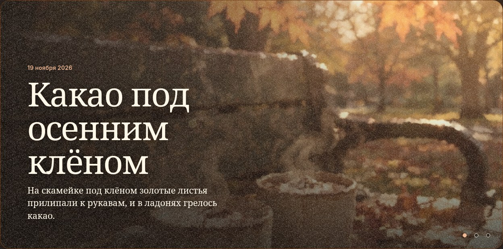
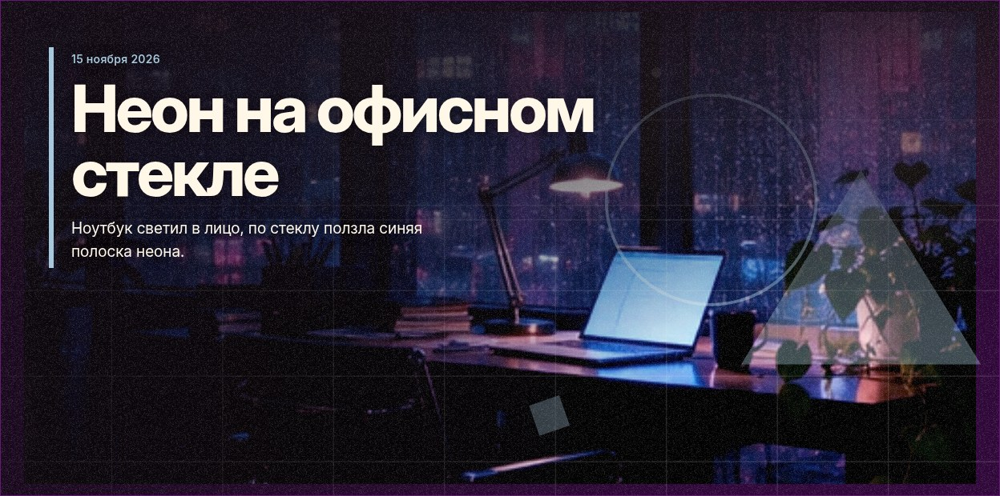
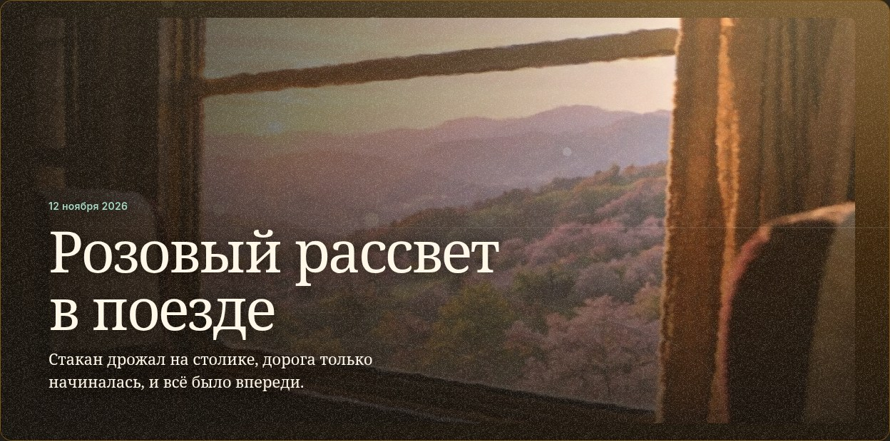
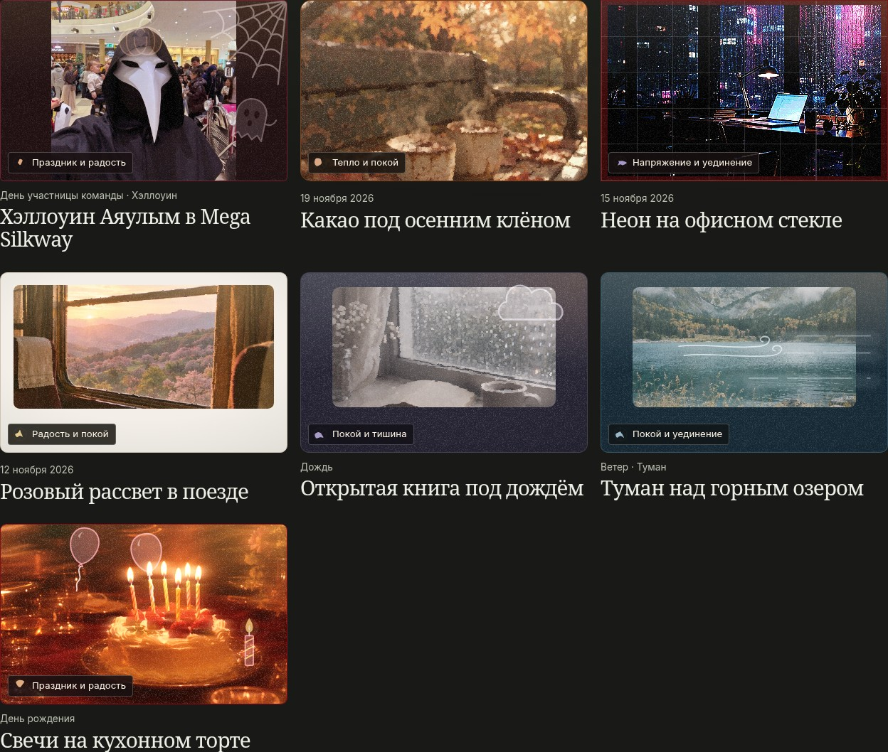
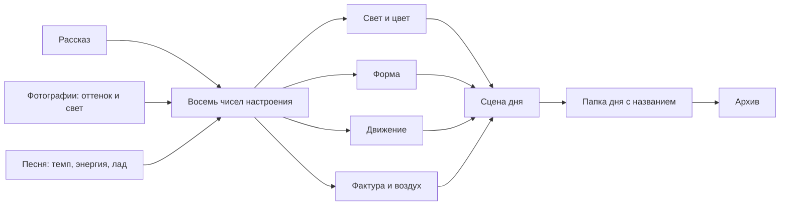

# Оттиск

**Личный дневник, который сохраняет атмосферу дня**

Рассказ, фотографии и песня превращаются в интерактивную сцену с собственным оформлением, музыкой и названием. Сцену можно открыть из архива или скачать папкой.

Genesis Hackathon 2026 · ArtTech · Make the Invisible Visible

[**Открыть прототип**](https://ottisk-eta.vercel.app/) · [Памятка для жюри](docs/jury-guide.md) · [Описание на одной странице](submission/ottisk-description.pdf) · [Художественные приёмы](submission/techniques.md)

| Тепло и покой | Напряжение и уединение | Радость и покой |
|:---:|:---:|:---:|
|  |  |  |
| Мягкие мазки и тёплый свет | Строгая сетка и плоскости цвета | Светлая палитра и поля |

<em>Три дня с разным настроением остаются страницами одного дневника. Нажмите на кадр, чтобы открыть сцену.</em>

## Содержание

- [Что сдано](#что-сдано)
- [Как день становится сценой](#как-день-становится-сценой)
- [Проверка за две минуты](#проверка-за-две-минуты)
- [Сильные стороны проекта](#сильные-стороны-проекта)
- [Запуск](#запуск)
- [Настроение в числах](#настроение-в-числах)
- [Создание записи](#создание-записи)
- [Музыка и экспорт](#музыка-и-экспорт)
- [Техническая реализация](#техническая-реализация)
- [Команда](#команда)
- [Лицензия](#лицензия)

## Что сдано

| Материал | Где смотреть |
|---|---|
| Прототип | [ottisk-eta.vercel.app](https://ottisk-eta.vercel.app/) · [запасная копия на GitHub Pages](https://abilkhayrbigali-design.github.io/omarches/) |
| Видео до трёх минут | 1:57, лежит в папке сдачи. В ролике настоящие фотографии людей, поэтому в открытый репозиторий он не входит |
| Примеры дней | [Семь дней с названиями папок](submission/examples/README.md) · [интерактивный архив](submission/examples/ottisk-examples.zip) |
| Описание на одной странице | [ottisk-description.pdf](submission/ottisk-description.pdf) |
| Художественные приёмы | [techniques.md](submission/techniques.md) |
| Код | Этот репозиторий; карта кода в разделе [Техническая реализация](#техническая-реализация) |
| Использованные инструменты | [Инструменты и ресурсы](submission/techniques.md#инструменты-и-ресурсы) |

## Как день становится сценой

Модель читает рассказ и возвращает восемь чисел в четырёх парах противоположностей. Фотографии и песня сдвигают эти числа и задают цвет и ритм сцены. Каждая пара управляет своим слоем оформления, поэтому смешанный день не усредняется: грустный, но шумный вечер будет тёмным по цвету и быстрым по движению. Правила разобраны в разделе [Настроение в числах](#настроение-в-числах).

## Проверка за две минуты

1. Откройте [«Какао под осенним клёном»](https://ottisk-eta.vercel.app/app/#day/maple) и нажмите **Воспроизвести**. Сравните мягкие мазки с жёсткой сеткой в [«Неоне на офисном стекле»](https://ottisk-eta.vercel.app/app/#day/office) и со светлым оттиском в [«Розовом рассвете в поезде»](https://ottisk-eta.vercel.app/app/#day/train).
2. В блоке **Как собрана сцена** раскройте **Поправить числа** и измените «Покой» и «Напряжение». Форма, шрифт, обработка фото и движение изменятся сразу. Строки «Кадры» и «Музыка» объясняют вклад ввода.
3. Нажмите **Записать день**. Введите рассказ, загрузите фото, добавьте песню из файла, каталога или по ссылке. Нажмите **Собрать воспоминание**, затем **Скачать папку дня**. Вернитесь в архив, найдите запись по названию и откройте снова.

Сценарий со своими фото и аудиофайлом работает без API-ключей. На главной видны три подборки с превью сцен. В галерее можно выбрать отдельный праздник, погоду или настроение либо посмотреть все 18 дней. Интерфейс доступен на русском, казахском и английском. [Галерея оформлений](https://ottisk-eta.vercel.app/app/#examples) · [Запасная версия на GitHub Pages](https://abilkhayrbigali-design.github.io/omarches/).

Язык интерфейса можно переключить независимо от языка записи. Текст сохраняется в оригинале, а интерфейс скачанной папки использует выбранный язык. Примеры охватывают девять погодных эффектов, четыре праздника и восемь настроений.

## Сильные стороны проекта

| Что проверять | Что показывает прототип |
|---|---|
| Атмосфера дня | Музыка звучит в сцене. Знаки погоды и праздника появляются по деталям рассказа, а темп озвучки зависит от настроения. |
| Единая визуальная система | Дата, кадр, цитата, проигрыватель и оттиск связывают дни. Цвет, форма, движение и фактура меняются по восьми числам. |
| Связь ввода и результата | Текст задаёт настроение и название, фото дают цвет и свет, анализ песни влияет на ритм и настроение. Вклад виден рядом со сценой. |
| Проверяемая реализация | Запись читает собственная модель: на сайте серверная, без сервера запасная в браузере. Ползунки позволяют проверить правила, а папка дня содержит готовую HTML-сцену и материалы. |

Подробности реализации и исходники приведены ниже. Для оценивания по критериям кейса используйте [памятку жюри](docs/jury-guide.md). Запись участницы команды открывается в галерее и в наборе из семи примеров. [Хэллоуин Аяулым в Mega Silkway](https://ottisk-eta.vercel.app/app/#day/ayaulym-halloween)

## Запуск

1. Распакуйте архив исходников и откройте терминал в папке с этим файлом.
2. Запустите `python3 server.py`. В Windows используйте `py server.py`.
3. Откройте [дневник в браузере](http://127.0.0.1:8765/). Для запуска нужен Python 3. Для поиска и прослушивания музыки из Openverse нужен интернет. Для диктовки нужен микрофон с разрешением на доступ. Русская речевая модель загружается с локального сервера по нажатию кнопки диктовки.

В разделе **Галерея оформлений** собраны демонстрационные записи. Откройте «Какао под осенним клёном», включите воспроизведение и озвучку. Для сравнения откройте «Неон на офисном стекле» и посмотрите, как вместе со сценой меняется весь сайт: цвет, шрифт, углы и сетка.

## Настроение в числах

Каждый день описывают восемь чисел от 0 до 1. Они стоят парами противоположностей, и каждая пара управляет своим слоем оформления.

| Пара | Чем управляет |
|---|---|
| Радость ↔ Грусть | Свет и цвет: светлота, насыщенность, тень по краям; в грустный день тени выцветают в серую дымку |
| Покой ↔ Напряжение | Форма: скругление углов, шрифт заголовка, сетка, резкость склеек; сам кадр ложится мазками или собирается в плоскости цвета |
| Праздник ↔ Тишина | Движение: скорость, размер заголовка, световые следы; свет на кадре тянется, как при длинной выдержке |
| Тепло ↔ Уединение | Фактура и воздух: засветка, зерно, поля вокруг кадра; длина и направление мазка; в уединённый день цвет кадра уходит в холодный |

Цвет сцены берётся от ведущего чувства, акцент — от второго по силе, сдвинутого на треть к цвету сцены. Оттенки не усредняются, поэтому смешанный день даёт два чистых цвета. Покой своего цвета не даёт: он отвечает за форму, а цвет спокойного дня берётся у соседнего чувства. Поэтому дождливый день серо-лиловый, день у озера холодный, а вечер с какао янтарный. Количество фигур поверх кадра (капли, круги, линии сетки, световые следы) тоже равно этим числам.

**Откуда числа.** На опубликованном сайте каждую запись читает серверная модель `mood-5`, о ней ниже. При запуске на компьютере и когда сервер не отвечает, запись читает запасная модель на устройстве. Эта локальная модель `mood-3` оценивает восемь чувств по словам, буквенным фрагментам и отдельным частям рассказа. Она учитывает отрицания и может отдельно заметить напряжение и облегчение в одной записи. Под оттиском видны слова, которые сильнее всего повлияли на оценку. В обучении использованы 2 290 размеченных примеров на русском, казахском и английском, включая 90 новых примеров с отрицаниями и смешанными чувствами. Корпус синтетический, поэтому показатели измеряют согласие с его разметкой.

На 165 отложенных записях на разные темы средняя абсолютная ошибка на шкале от 0 до 1 снизилась с 0,149 до 0,145 относительно `mood-2`. На 160 записях о переезде она составила 0,163 у обеих версий после округления. Новая модель правильно различила все 18 специально составленных пар с отрицаниями. Переобучение запускается командой `node tools/mood-model/train.mjs --fast`, сравнение версий — `node tools/mood-model/evaluate.mjs`.

На Vercel запись читает серверная модель: текст отправляется на сервер «Оттиска» только для анализа и там не хранится. После ручной правки чисел кнопка **Прочитать запись заново** возвращает оценку модели. `mood-5` определяет главное настроение с помощью замороженного энкодера multilingual E5 и обученных на 2 866 записях классификаторов. `mood-4` даёт базовые интенсивности и служит резервным вариантом. Веса энкодера загружаются с Hugging Face в серверный кеш. Сама запись обрабатывается функциями «Оттиска».

Проверка `audit-300.mjs` использует 100 синтетических записей на каждый язык: 30 чистых, 30 с грамматическими или пунктуационными ошибками и 40 с опечатками. Целевой показатель — от 90 точных ответов из 100 по каждой из девяти комбинаций языка и категории. Для проверки новой модели используйте `node tools/mood-model/audit-300.mjs --dump | python tools/mood-model/predict-primary.py | node tools/mood-model/audit-300.mjs --stdin --verify`. Для обучения подготовьте корпус командой `node tools/mood-model/prepare-primary.mjs > /tmp/ottisk-primary-train.jsonl` и запустите `python tools/mood-model/train-primary.py /tmp/ottisk-primary-train.jsonl`. Для обучения в дополнение к серверным зависимостям нужен scikit-learn.

Название папки дневник берёт из самой записи. Если к серверу подключён ключ OpenAI, галочка **Прочитать запись моделью OpenAI вместо своей** отправляет текст в OpenAI. При запуске на компьютере без этой галочки текст обрабатывается на устройстве. Модель OpenAI по умолчанию — `gpt-5.6-terra`, её можно заменить переменной окружения `OTTISK_TEXT_MODEL`. Числа и названия шести примеров сохранены заранее. Если новые веса недоступны, дневник пробует `mood-2`, затем встроенный русский словарь.

**Музыка и фото.** Музыка сдвигает пары «Праздник ↔ Тишина» и «Радость ↔ Грусть» на четверть пути к тому, как она звучит, и задаёт время кадра. У своего аудиофайла дневник определяет темп, энергию и лад (мажор или минор); если лад не выражен ясно, он воздерживается от вывода, и тогда песня не меняет свет сцены. Трек, выбранный из каталога Openverse, разбирается так же: сервер скачивает его для анализа, потому что издатель не разрешает странице читать звук напрямую. Локальный сервер берёт трек целиком, серверная функция сайта — только начало, которого хватает для анализа. Файл трека при этом не сохраняется. В копии без серверной части характер трека оценивается по его тегам. Оттенок фотографии подмешивается к цвету сцены тем слабее, чем он дальше от цвета чувства и чем больше в дне грусти и уединения. Кадры ещё и слегка сдвигают числа: тёплые цвета добавляют тепла, холодные — уединения, плотный насыщенный кадр — праздника, светлый и цветной — радости, тёмный и серый — грусти. Сдвиг происходит только при ясном перевесе. Дневник измеряет цвет и свет кадра и не распознаёт, что на нём изображено.

**Обработка кадра.** Те же числа меняют и саму фотографию. Покой выше примерно 0,3 раскладывает кадр на мазки: при тепле они короткие и круглые, при уединении и тишине — длинные и ровные, вдоль горизонта. Напряжение выше 0,3 собирает кадр в плоскости цвета с жёсткими границами. При празднике выше 0,4 свет на кадре тянется в стороны, как при длинной выдержке. Сила обработки растёт вместе с числом, поэтому ползунки меняют её сразу. Обработка сделана фильтром SVG и сохраняется в скачанной папке дня.

**Композиция.** Кадр и слова стоят по-разному, шесть раскладок. В тёплый или ровный день слова лежат на кадре слева внизу. При напряжении выше половины они встают вверху у акцентной полосы, по сетке. В праздничный день заголовок крупный, по центру и с наклоном. В уединённый или тихий день небольшой кадр стоит в широких полях, подпись под ним. Если день ведёт грусть, кадр обрезан и уходит в темноту, а слова опускаются в дальний угол. Если день ведёт радость и кадр не ночной, запись становится светлым отпечатком с подписью на нижнем поле, и вся страница дня светлая. Карточки в архиве повторяют раскладку своего дня. Строка **Композиция** в блоке «Как собрана сцена» называет правило.

**Движение.** Те же четыре пары решают, как всё движется. Из восьми чисел считается пружина: жёсткость, затухание и масса. «Праздник ↔ Тишина» задаёт скорость и паузу между соседними элементами. «Покой ↔ Напряжение» — характер: в спокойный день пружина мягкая и заголовок выходит из расфокуса, в напряжённый она жёсткая, элементы входят сбоку вдоль сетки, а заголовок открывается резкой шторкой. «Радость ↔ Грусть» — направление и вес: в радостный день элементы поднимаются снизу с отскоком, в грустный медленно опускаются сверху. «Тепло ↔ Уединение» — расстояние: в тёплый день элементы приближаются, в уединённый приходят по одному. При открытии дня его карточка вырастает в сцену и возвращается на место по дороге назад. В показе камера приближается в тёплый день и отдаляется в уединённый, кадр плывёт вверх при радости и опускается при грусти, а в напряжённый день движется рывками. Карточка в архиве отвечает на курсор в характере своего дня. Правило записано словами в строке **Движение** блока «Как собрана сцена». Если в системе включено «уменьшить движение», ничего не перемещается: остаются смена цвета и проявление.

**Страница.** От чисел зависят не только цвет, шрифт и углы сайта. Уединение и тишина раздвигают разделы и карточки, праздник и напряжение сжимают. Свет страницы при радости стоит сверху, при грусти опускается под страницу, тепло тянет его в угол. Грусть и уединение затемняют края страницы, напряжение делает линии между разделами заметнее и набирает мелкие подписи прописными. Строки текста записи шире расставлены в тихий день и плотнее в напряжённый.

**Праздники и погода.** Дневник замечает не только то, каким был день, но и о чём он был. Если в записи назван праздник — Хэллоуин, Новый год, день рождения или Наурыз — или описана погода, на сцене и на карточке архива появляются их знаки: тыквы, призраки и паутина; ёлка, снежинки и гирлянда; шары, свечи и флажки; шаңырақ, орнамент «қошқар мүйіз», алтыбақан и тюльпаны; солнце, облако, дождь и снег из облака, ветер, туман, гроза, зной и иней. Это тонкие линии и бледные формы в графике дневника, а не наклейки: цвет берётся из акцента дня, знаков больше в праздничный день. Знаки на кадре движутся во время показа, а на странице открытого дня праздник идёт всё время: в Хэллоуин через окно летят полупрозрачные призраки и летучие мыши, в Новый год идёт небольшой снег, в Наурыз летят лепестки и ласточки, а у нижнего края растёт молодая трава, в день рождения поднимаются шары и сыплется конфетти. Скорость, размах и характер этого движения берутся из настроения дня: в праздничный день оно быстрое и размашистое, в тихий медленное и почти прямое, в напряжённый дёрганое. Погода из записи тоже идёт по всей странице дня. Облака плывут через верх окна, и их скорость растёт и падает вместе с настроением. Снег падает сверху, понемногу ложится на края интерфейса (на сцену, кнопки, проигрыватель, линии) и смахивается курсором. Капли дождя падают по всему окну и иногда отскакивают от этих краёв мелкими брызгами. В день с Новым годом небольшой снег идёт и ложится так же. Распознавание работает на устройстве по словам на русском, казахском и английском, понимает отрицания («дождя не было», «без ёлки») и идиомы («как снег на голову»). Дата лишь подкрепляет праздник и никогда не решает за текст. Знаки перечислены в блоке **Как собрана сцена** вместе со словами записи, по которым они появились.

**Правка.** На странице дня в блоке **Как собрана сцена** видны числа и правила, которые сработали. Под ними — **Поправить числа**: ползунки меняют сцену и оформление сайта сразу. Кнопка **Редактировать день** открывает запись для правки: новый текст заново прочитает модель «Оттиска», а модель OpenAI — по отдельной кнопке, если подключён ключ. **Удалить день** убирает запись из браузера после подтверждения.

**Дневник целиком.** На главной странице числа считаются по всем дням по порядку. Каждый день сдвигает их примерно на десятую часть пути к себе, а чувство, которое вело день, дополнительно теснит свою противоположность. После грустного дня радости становится немного меньше, а грусти больше. Ведущий цвет и акцент меняются, только когда другое чувство уходит вперёд с запасом, поэтому одна запись не перекрашивает сайт. Знак в шапке — оттиск дневника: восемь лучей, противоположные чувства на противоположных сторонах.

Числа описывают текст записи, а не состояние автора.

## Генерация изображений через OpenAI

Иллюстрации создаёт модель `gpt-image-2.6-flare` через OpenAI Images API. Для генерации нужны интернет и ключ проекта OpenAI с доступом к модели и оплатой запросов. Для записи со своими фотографиями достаточно локального сервера. [Модель GPT Image 2.6 Flare](https://developers.openai.com/api/docs/models/gpt-image-2.6-flare)

1. Создайте ключ в своём API-проекте. [Страница ключей OpenAI](https://platform.openai.com/api-keys)
2. В терминале из корня проекта выполните `python3 server.py --set-image-key` и вставьте ключ в скрытое поле. Он хранится на стороне сервера. Также можно запустить сервер с переменной окружения `OPENAI_API_KEY`. Этот же ключ нужен, если автор хочет, чтобы запись читала модель OpenAI.
3. На шаге с кадрами проверьте описание. Изначально это текст записи. Его можно сократить или переписать специально для иллюстрации. Выберите стиль и нажмите кнопку создания изображения. В этот момент сервер отправит OpenAI отредактированное описание и стиль. Платный запрос выполняется только по нажатию. Загруженные фотографии остаются в браузере.

## Озвучка рассказа

В семи примерах для жюри заранее записана синтезированная озвучка. Она доступна офлайн. Песня дня Аяулым воспроизводится из каталога через интернет. Для синтеза новых озвучек в корне проекта выполните `python3 tools/install_voice.py`. Установщик поддерживает Python 3.10–3.13 с `venv`. Проверенная конфигурация — Linux x86_64 с Python 3.11. Готовая сборка PyTorch для неё требует glibc 2.28 или новее. При первой установке нужен интернет. Модель Silero TTS `v5_6_ru` весит около 141 МиБ, вместе с CPU-версией PyTorch и остальными зависимостями занимает около 1 ГиБ в `.voice-runtime/`. После установки запустите `python3 server.py`. Сервер синтезирует речь на этом компьютере.

В разделе **Озвучка записи** дневник сам предлагает голос по числам дня: Бая — для тёплых и праздничных записей, Ксения — для светлых, Ксения II — для тихих и грустных, Айдар — для уединённых, Евгений — для напряжённых. Общий темп чтения тоже берётся из чисел: праздничный день читается чуть быстрее, тихий — медленнее. Голос можно сменить и послушать **Пример голоса**. Кнопка **Прочитать запись** озвучит весь рассказ выбранным голосом. Подача меняется по фразам с учётом текста и пунктуации. Сохранённая версия звучит при повторном открытии дня и попадает в ZIP вместе со сведениями о голосе.

Модель разработала Silero Team. Лицензия весов **CC BY-NC-SA 4.0** разрешает некоммерческое использование с указанием автора и сохранением лицензии для распространяемых переработок модели. Для коммерческого использования модели требуется отдельное разрешение. Авторский текст остаётся частью дневника, а синтезированная аудиодорожка сохраняется как отдельный файл. [Лицензия релиза Silero v5.6](https://github.com/snakers4/silero-models/blob/v5.6/LICENSE)

## Создание записи

1. **Расскажите о дне.** Нажмите **Записать день**. Выберите дату и опишите событие. Для голосового ввода нажмите **Надиктовать день**, разрешите доступ к микрофону и произнесите рассказ по-русски. Проверьте текст, при необходимости исправьте его. Запись прочитает собственная модель дневника; если подключён ключ OpenAI, галочкой можно выбрать вместо неё модель OpenAI. Нажмите **Добавить фотографии**.
2. **Соберите кадры.** Загрузите свои фотографии или откройте **Изображение по рассказу**. Выберите **Плёночное фото**, **Акварель** или **Цветная линогравюра** и запустите генерацию через OpenAI, предварительно проверив описание сцены. Посмотрите результат и нажмите **Добавить к кадрам** либо создайте другой вариант. Одной принятой иллюстрации достаточно. Её можно сочетать с фотографиями, например с `maple.webp` из `app/media/`. Когда кадры собраны, нажмите **Подобрать музыку**.
3. **Выберите музыку.** По деталям рассказа дневник подберёт поисковые теги и запросит треки в Openverse. Прослушайте вариант, проверьте автора и условия использования. Кнопка **Ещё треки** расширяет список. Также доступны **Аудиофайл**, **Ссылка** и **Сочинить**.
4. **Сохраните день.** Нажмите **Собрать воспоминание**. Откроется сцена с названием, цитатой и проигрывателем, а сайт примет оформление этого дня. В разделе **Как собрана сцена** видны восемь чисел и вклад текста, фотографий и музыки.

Для проверки подойдёт этот рассказ.

> Осенью мы встретились в парке после работы. На скамейке под клёном золотые листья прилипали к рукавам, и в ладонях грелось какао. Мы долго говорили, пока не погас последний тёплый луч.

После сохранения найдите день по слову «какао» в личном архиве. Перезагрузите страницу и откройте его ещё раз. Кнопка **Редактировать день** позволяет исправить название и рассказ, переставить или заменить кадры и выбрать другую песню. Примеры доступны отдельно от личных записей.

Для проверки смены настроения попробуйте рассказ: «Сначала я очень нервничал перед выступлением. Потом пришли друзья, я выдохнул и рассмеялся. На память я спрятал медную пуговицу в карман». Добавьте хотя бы два кадра и включите сцену. Если в рассказе различимы начало и конец с разным настроением, оформление меняется по ходу воспоминания, а подпись сохраняет конкретную деталь из текста.

## Музыка и экспорт

Поиск обращается к действующему каталогу Openverse. Дневник отправляет музыкальные теги, которые получает из рассказа на устройстве. Для выбора доступны записи, отмеченные в каталоге CC BY или CC0. Перейдите к источнику и точной версии лицензии у конкретной композиции. Для CC BY при публикации сохраните сведения об авторе и условиях использования, а при изменении произведения укажите изменения. [Условия CC BY](https://creativecommons.org/licenses/by/4.0/deed.ru) · [Условия CC0](https://creativecommons.org/publicdomain/zero/1.0/deed.ru)

Кнопка **Скачать папку дня** выгружает ZIP с HTML-сценой, текстом, файлами всех принятых кадров и параметрами оформления. Для сгенерированных кадров в `memory.json` указаны провайдер, модель и выбранный стиль. Для композиции Openverse сохраняются адрес онлайн-проигрывания, источник, имя автора и лицензия. Для её воспроизведения требуется подключение к интернету и доступность файла у издателя. Загруженные автором записи и сочинённые приложением мелодии попадают в ZIP аудиофайлами. Распакуйте архив и откройте корневой `index.html`.

Личные записи хранятся в IndexedDB текущего профиля браузера. Для переноса нажмите **Скачать мой архив**, затем откройте «Оттиск» в другом профиле или на другом устройстве и нажмите **Восстановить из ZIP**. Существующие записи с теми же идентификаторами сохраняются.

## Техническая реализация

| Компонент | Что делает |
|---|---|
| `app/feelings.mjs` | Восемь чисел настроения, запасной словарь, правила оформления сцены и сайта, пересчёт чисел дневника по всем дням |
| `app/feelings.mjs` (`motionTokens`), `tools/motion-test.mjs` | Пружина движения из восьми чисел: жёсткость, затухание, масса, направление и пауза между элементами; проверка правил на девятнадцати утверждениях |
| `app/own-model.mjs`, `app/model/` | Собственная модель чтения записи: признаки текста, веса (512 КБ), оценка восьми чисел и объяснение словами записи |
| `tools/mood-model/` | Корпус из 1040 размеченных записей, обучение (`train.mjs`) и проверка (`evaluate.mjs`) модели |
| `app/context-page.mjs`, `app/weather.mjs` | Праздник и погода на всей странице дня: летящие знаки праздника, плывущие облака, снег, который ложится на края интерфейса и смахивается курсором, дождь с брызгами |
| `app/context.mjs`, `app/context-signs.mjs` | Праздник и погода из текста записи и их знаки на сцене и карточке; `tools/context-test.mjs` проверяет распознавание 62 проверками |
| `tools/story_reading.py`, `app/reading.mjs` | Выбор читателя записи: своя модель, по желанию автора модель OpenAI (запрос к Responses API со строгой схемой ответа), в крайнем случае словарь |
| `app/scene.mjs` | Разметка сцены, генеративный слой фигур, обработка кадра фильтром SVG, оттиск настроения и шкалы пар. Общая для страницы и экспорта |
| `app/atmosphere.mjs` | Извлекает доминирующий оттенок и светлоту фото, анализирует аудио и собирает оформление дня |
| `server.py`, `app/image-picker.mjs` | Запрос к OpenAI Images API, получение иллюстрации, предпросмотр и добавление кадра |
| `tools/narration_style.py`, `tools/neural_voice.py` | Делят рассказ на фразы, подбирают паузы и темп и синтезируют чтение выбранным голосом |
| `app/voice-entry.mjs` | Распознаёт русскую речь в браузере и добавляет результат в редактируемый рассказ |
| `app/music-query.mjs`, `app/online-catalog.mjs`, `app/music-picker.mjs` | Переводят признаки рассказа в поисковые теги, запрашивают и ранжируют результаты, показывают авторство и лицензию, отдают выбранный трек на анализ звука |
| `app/compose-music.mjs` | Синтезирует инструментальный WAV для режима «Сочинить» |
| `app/main.mjs`, `app/style.css` | Форма записи, архив, поиск, сцена, проигрывание, озвучка и оформление сайта по числам |
| `app/storage.mjs`, `app/export.mjs` | Сохранение в IndexedDB, экспорт папок дней и восстановление личного архива |
| `app/demos.mjs`, `tools/demo_audio.py` | Шесть демонстрационных историй, оригинальная инструментальная музыка и синтетическая речь |
| `tools/record-demo.mjs` | Сценарий демо-ролика: управляет дневником в Chromium, записывает экран, добавляет титры и звук. День, который показан в ролике, задан в начале файла |
| `tools/description.html` | Исходник одностраничного описания; печатается в PDF через Chromium |
| `tools/capture-examples.mjs` | Переснимает картинки и интерактивный архив в `submission/examples` с работающего дневника |
| `tools/package.py` | Собирает архив исходников и общий архив сдачи и сверяет их с файлами на диске |
| `hosted/api/reading.py`, `hosted/api/music.py`, `hosted/vercel.json` | Серверные функции опубликованного сайта: чтение записи моделью и начало трека из каталога для анализа звука |
| `hosted/api/mood.mjs`, `hosted/api/mood_semantic.py`, `mood-server/` | Серверная модель настроения, которая читает каждую запись на сайте: `mood-4` даёт восемь чисел и слова, повлиявшие на оценку, `mood-5` на энкодере multilingual E5 определяет главное настроение |
| `app/restore.mjs`, `app/zip.mjs` | Восстановление личного архива из ZIP в другом браузере |
| `tools/vercel_site.py` | Собирает папку для публикации сайта: приложение и серверные функции |
| `tools/feed-check.mjs` | Лист из тринадцати дней от горя до громкой радости: сверка, что дни различимы и остаются страницами одного дневника |

## Публикация сайта

`python3 tools/vercel_site.py` собирает папку `.hosted/ottisk`: приложение и серверные функции чтения записи и анализа трека. Команда `npx vercel deploy --prod --yes .hosted/ottisk` публикует её на Vercel. Ключ OpenAI в папку не попадает. Запись на сайте читает собственная серверная модель «Оттиска», ключ для этого не нужен. Чтобы автор мог выбрать вместо неё модель OpenAI, владелец проекта добавляет ключ в настройки Vercel командой `npx vercel env add OPENAI_API_KEY production` из папки `.hosted/ottisk` и публикует сайт ещё раз. Перед этим стоит задать месячный лимит расходов в проекте OpenAI: сайт открыт всем. Функция чтения отвечает только страницам своего сайта и ограничивает число записей с одного адреса.

Шрифты Noto Serif и Adwaita Sans распространяются по лицензии SIL OFL 1.1, тексты лицензий лежат в `app/media/`. Оформление сверено с правилами ремесла из [Open Design](https://github.com/nexu-io/open-design) (Apache 2.0); код этого проекта не используется. Движение сверено с правилами [Impeccable](https://github.com/pbakaus/impeccable) (Apache 2.0), [Taste Skill](https://github.com/leonxlnx/taste-skill) (MIT) и [Motion](https://github.com/freshtechbro/claudedesignskills/blob/main/.claude/skills/motion-framer/SKILL.md) (MIT); взяты только правила, библиотека Framer Motion и код этих проектов не используются.

В примере «Хэллоуин Аяулым в Mega Silkway» использованы шесть предоставленных командой фотографий. В записи звучит «skeleton dance» исполнителя Blik из каталога Jamendo. Остальные демонстрационные истории используют синтетические фотографии и музыку проекта. Для собственных записей используйте фотографии с разрешением и аудио с подходящими условиями.

## Команда

- Абулхаир — дизайн сайта;
- Чингиз — проверка кода;
- Аяулым — логика сервиса;
- Нурсултан — тимлид.

Код прототипа написан с помощью ИИ-ассистентов для программирования — Codex (OpenAI) и Claude Code (Anthropic). Идею, логику сервиса и оформление определяла команда; она же ставила задачи ассистентам и проверяла результат.

## Лицензия

Исходный код «Оттиска» распространяется по [лицензии MIT](LICENSE).

Лицензия не распространяется на материалы, у которых свои условия:

- **Фотографии дня Аяулым** в `app/media/ayaulym-halloween/` и снимки с ними в `submission/examples/` показаны с разрешения участницы команды только как пример работы дневника. Отдельно от проекта их использовать нельзя.
- **Распознавание речи** в `app/vendor/voice/`: Vosk Browser и русская модель vosk-model-small-ru-0.22, лицензия Apache 2.0. Тексты лицензий лежат в той же папке.
- **Шрифты** Noto Serif и Adwaita Sans: лицензия SIL OFL 1.1, тексты в `app/media/`.
- **Трек «skeleton dance»** исполнителя Blik звучит по ссылке из каталога Jamendo на условиях CC BY 3.0 и в репозиторий не входит.
